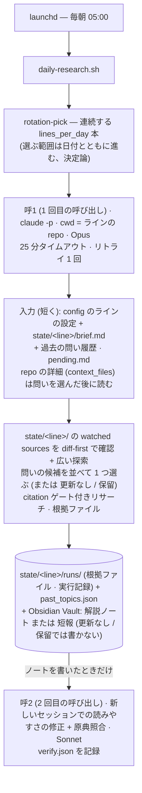

Language: [English](README.md) | 日本語

# daily-research

**毎朝、研究 repo に関わる外部の動向を 1 つと、それを repo にどう使えるかを解説したノートが Obsidian Vault に届きます。** 毎朝、[Claude Code](https://docs.anthropic.com/en/docs/claude-code)（英語）が、研究ライン (line) のうち数本について、*そのラインの repo を作業ディレクトリとして* 起動されます（ラインは研究 repo 1 つと、その周りで見張る対象の組です）。repo 自身の運用文脈（CLAUDE.md、タスク台帳、開いた問い、実施履歴）を読み、新しい発表の場・仕組み・仕様・締切付きの機会といった **repo に関係する外部の動向**を 1 つ問いの形で選び、何が起きたか・なぜ重要か・この repo にどう使えるかを解説します。ノートは前提知識ゼロで読めるように書かれ、[Obsidian](https://obsidian.md) Vault に置かれます。朝のコーヒーと読む読み物であって、todo キューではありません。

[](LICENSE) [](https://deepwiki.com/shimo4228/daily-research) 

macOS の `launchd` で無人で動きます。API を呼ぶためのコードも、オーケストレーション用のフレームワークも使いません。shell スクリプトが Claude Code の非対話モード (`claude -p`) を動かし、stdlib だけで書いた小さな Python モジュールが JSON/TOML を解析します。リサーチの中身を決めているのはプロンプトです。

> **対象**: 研究リポジトリを 1 つ以上運用していて、汎用トレンドでも裏付けサーベイの山でもなく、repo の実際の仕事に関わる外部の動向を 1 つ、毎日自律的に解説してほしい人。

**外に出るものと費用。** 各回の実行は Claude Code のセッションなので、実行中に読んだもの（repo の CLAUDE.md、タスク台帳、`context_files` に挙げたファイル、ラインの `state/` のファイル）は Anthropic に送られ、実行中は Web を検索・取得します。repo へは書き込まないよう指示してあり、書き込みの許可も Vault のレポートの置き場と、ラインの `state/` のうち数ファイルだけに絞っています（この許可がどこで効かなくなるかは「[中核概念](#中核概念)」の「repo は read-only」にあります）。誰が払うかは `config.toml` の `[billing] mode` で決めます。`subscription`（既定）は Claude Code のログインを使います。Max プランならトークン単位の課金はなく、ほかの Claude Code の利用と同じくプランの利用上限に数えられます。設定なしに課金経路が変わらないよう、環境にある `ANTHROPIC_API_KEY` は捨てます。`api` は repo の外の env ファイルから `ANTHROPIC_API_KEY` を読み、すべての呼び出しを Claude API の課金にします。呼び出しごとに支出の上限があり、1 日または 1 か月の上限を超えそうになると残りのラインを止めて通知します。著者は `api` で動かしています。その月の支出は `./scripts/check-auth.sh` が表示します。上限の仕組みは [RUNBOOK](docs/RUNBOOK.ja.md#コスト) にあります。

作り方を書いた記事と、そのノートをもとに育つ観測のリポジトリは「[著者のほかの仕事](#著者のほかの仕事)」にあります。

## 仕組み



図の流れを文で言うと次のとおりです。05:00 に launchd が `scripts/daily-research.sh` を起動し、その日のラインを選びます。輪番から連続する `[general] lines_per_day` 本の repo ラインと、`daily = true` の全ラインです。各ラインは次の順に進みます。

1. **呼1**（Opus、ラインの repo が作業ディレクトリ）は短い入力から始めます。入力は `config.toml` のラインの設定（名前、focus、sources）、全ラインが共有する `[general]` の設定 `self_signals`（あなた自身の成果物を示す文字列）、`state/<line>/brief.md`（ラインの主題、読者が知っている前提、repo の参照箇所。あなたが書き、実行は読むだけ）と `pending.md`（保留の問い）、直近 14 日の repo の commit 件名、`past_topics.json` から取ったラインの最近の問いです。`past_topics.json` は毎回の実行の後にスクリプトが追記する過去の問いの履歴で、すでに答えた問いをもう一度立てないために読みます。ただし、同じ問いでも新しい証拠があれば、更新として取り上げ直せます。`context_files` に挙げたファイルは、問いを選んだ後にだけ読みます。
2. 呼1 はまず、ラインの監視ソースのうち前回の実行から変わったところだけを確かめます。これを diff-first パスと呼びます。次に問いの候補を並べて 1 つ選ぶか、ノートを書かずに止めます。止め方は、新しいことがない「更新なし」と、問いは立つが 1 回の実行では確かめられない「保留」（問いは再開の条件とともに `pending.md` に預けられます）で、どちらも正常な結果です。どちらの場合も、実行がどう終わったかを実行記録（run receipt）に書きます。
3. 問いを選んだときは、調べてノートを書き、ノートが拠って立つ 3〜6 件の主張を並べた根拠ファイルも書きます。引用するのは実行中に WebFetch で取得できたページだけです（これを citation ゲートと呼びます。取得できなかった出典は落とすか「未解決」と書きます）。あなた自身の成果物（`self_signals`）は外部の動向として数えません。
4. **呼2**（既定 Sonnet、研究の文脈を持たない新しいセッション）は、呼1 がノートを書いたときだけ走ります。初見の読者がつまずく箇所を直したあと、根拠ファイルの主張ごとに原典を取り直して突き合わせ、食い違う箇所を直し、各主張が原典とどう合ったかの件数を `verify.json` に記録します。呼2 が失敗しても、ノートは未検証のまま残ります。

つまり、更新なし・保留で終わるラインは `claude -p` を 1 回、ノートを書くラインは 2 回呼び、呼1 が失敗してリトライしたときはそれに 1 回加わります。

実行の手順の全体（ロック、認証プローブ、2 回の呼び出し、レポートのゲートと lint）は [RUNBOOK のアーキテクチャ節](docs/RUNBOOK.ja.md#アーキテクチャ)にあります。呼1 への指示そのものは [prompts/repo-research-protocol.md](prompts/repo-research-protocol.md)（ecosystem ラインは [prompts/ecosystem-research-protocol.md](prompts/ecosystem-research-protocol.md)）、呼2 は [prompts/verification-protocol.md](prompts/verification-protocol.md) です（3 つとも日本語）。

## 前提条件

| 要件 | 備考 |
|------|------|
| [Claude Code CLI](https://docs.anthropic.com/en/docs/claude-code)（英語） | Claude Code のドキュメントのとおりに入れ、一度 `claude` を対話的に起動してログインする |
| [Claude Max プラン](https://claude.ai) または [Claude API](https://platform.claude.com) の key | どちらか一方。`[billing] mode` で選ぶ（冒頭の費用の段落を参照） |
| `python3` >= 3.11 | JSON/TOML 解析に stdlib のみ（`json` / `tomllib` / `re`）。macOS system 3.9 は `tomllib` 非対応のため Homebrew の `python3` を使う |
| macOS | スケジューリングに `launchd` を使用（Linux は `cron` / `systemd` に適宜変更） |
| coreutils の `timeout` | 必須。無いとスクリプトは開始時に止まる。Homebrew で入れる（`brew install coreutils`） |
| Obsidian (任意) | Markdown 対応ツールなら何でも可 |
| 研究リポジトリ | 実行時に読める運用文脈（CLAUDE.md、タスク台帳、開いた問い）を持つ repo を 1 つ以上 |

## クイックスタート

```bash
# 1. クローン
git clone https://github.com/shimo4228/daily-research.git daily-research
cd daily-research

# 2. 設定: vault_path と、設定例のラインの target_repo (テスト実行が読む repo) を設定し、
#    self_signals を自分のハンドルと名前にしてから、ほかのライン (1 line = 1 repo) を定義
cp config.example.toml config.toml

# 3. スクリプトに実行権限を付与
chmod +x scripts/*.sh

# 4. Claude の認証を確認（[billing] で選んだ経路で実際に 1 回呼び出す）
./scripts/check-auth.sh

# 5. 1 ラインだけのテスト実行（設定例のライン名は example_line）。当日の担当外でも走る。
#    DR_FORCE_TRACK を付けないと、当日担当の全ラインを順に実行する
DR_FORCE_TRACK=example_line ./scripts/daily-research.sh

# 6. launchd でスケジュール (任意): 05:00 リサーチ
cp com.example.daily-research.plist com.daily-research.plist             # YOUR_USERNAME と repo のパスを編集
ln -sf "$(pwd)/com.daily-research.plist" ~/Library/LaunchAgents/
launchctl load ~/Library/LaunchAgents/com.daily-research.plist
```

呼1 は 25 分で打ち切られ、失敗すると 1 回だけリトライされます。ノートを書いたときはそのあとに呼2（上限 20 分）が続くので、1 ラインに最長でおよそ 70 分かかります。テスト実行が終わると、ノートは `{vault_path}/{output_dir}/` に `{date}_example_line_{slug}.md` として置かれ（ラインが更新なし・保留で終わったときはノートはありません）、どの状態で終わったかを書いた実行記録は `state/example_line/runs/{date}.json`、ログは `logs/YYYY-MM-DD.log` にあります。ノートは、プロンプトを変えない限り日本語で書かれます（「[ラインの設定](#ラインの設定)」の末尾を参照）。リポジトリにノートの実例は入っていません。ノートの形（frontmatter、自由形式の本文、末尾の固定 2 節）は [templates/report-template.md](templates/report-template.md) が決めています。

**Claude Code skill としてインストール**: このリポジトリはルートに [`SKILL.md`](SKILL.md)（英語）マニフェストを備えているため、`~/.claude/skills/daily-research` へ clone すると `/daily-research` で呼び出せます。これは同じリポジトリを別の場所に置くだけで、2 つ目のインストールではありません。clone は 1 回だけ、そこか別の場所に行い、そのパスを launchd の plist に書いてください。

## ラインの設定

各 `[tracks.X]` エントリは研究 **ライン (line)** で（設定と `DR_*_TRACK` 変数ではまだ *track* と呼びます）、`[[tracks.X.repos]]` エントリ 1 つで研究リポジトリ 1 つにマッピングされます。関心領域は、実行時に repo の中から読まれる repo 自身の運用文脈です。`daily = true` のラインは輪番の外で毎朝走ります（[ADR-0011](docs/adr/0011-daily-line.md)。ADR は `docs/adr/` にある設計判断の記録で、日本語です）。`mode = "ecosystem"` のラインは repo を持たずに外部のエコシステムを見張り、`state/<line>/` から `--safe-mode` で走ります（[ADR-0018](docs/adr/0018-ecosystem-mode-and-daily-jev-line.md)）。各項目の説明は [config.example.toml](config.example.toml) のコメントにあり、両方の mode のライン例が 1 つずつ入っています。

レポートはデフォルトで日本語生成です。出力言語は `prompts/repo-research-protocol.md`（および `prompts/ecosystem-research-protocol.md`）の言語制約を変更します。

## 中核概念

- **4 つの内容状態** — どの実行も `article`（解説ノート。本文 3,000 字以内で、材料が薄ければ短く）、`brief`（短報。300〜600 字）、`quiet`、`hold` のいずれかで終わり、実行記録に記録されます。レポート存在ゲートはこの実行記録を読みます: 実行記録が無い・壊れているラインは失敗、`article` / `brief` はノートのファイルを要求、`quiet` / `hold` はファイル無しで成功（全ライン quiet の日も成功）。取得失敗が疑われる quiet / hold は metrics で別に数えます。
- **ノートの形** — 既定のテンプレートでは**固定見出しを置かない**自由形式の散文で、前提知識ゼロの読者向けに書かれます。冒頭は外部の出来事から始め、すべての主張に日付を付け、出典の主張・推論・含意を分けて書きます。末尾に機械検査対象の固定 2 節: 「機会メモ」（日付付き締切を持つ機会のみ: 何を / どこで / 失効日 / 判定の出典 / 更新条件）と「ソース」。提案・承認要求は書きません。
- **repo は read-only** — マッピングされた repo は編集しない決まりで、三層で守ります: 方針（プロトコルの文言）+ 実行（書き込み先は vault のレポートの置き場と、ラインの `pending.md`・`runs/` のみ）+ 権限の層（各呼び出しは `--permission-mode default` で走るので、設定の既定が auto mode でも `--allowedTools` のパスの外への編集は拒否される。`--disallowedTools` の拒否の層は Bash と、Claude Code の設定・資格情報のフォルダの読み取りを止める）。両方の呼び出しは `--safe-mode` で走り、あなた自身の CLAUDE.md・skill・plugin・hook は読み込まれません（[ADR-0019](docs/adr/0019-wide-line-safe-mode-static-state.md)）。

設計判断とその理由は [ADR](docs/adr/README.md) にあります。フラグ・書き込み先・拒否の規則の正確な値は `scripts/daily-research.sh` にあります。

## 注意事項

- **Claude Code セッション内からも実行できます**: `lib/env.sh` が `CLAUDECODE` を unset するため、ネストセッションチェックを通ります。ほかのテスト用の環境変数は [CONTRIB](docs/CONTRIB.ja.md) にあります。
- **API モードは再試行せずに止まる**: 429、クレジット残高の不足、key の拒否のどれかが出ると、残りのラインを止めて通知します。呼び出しごとの費用は `state/api-spend.jsonl` に追記され、1 日と 1 か月の上限はこれを読みます。
- **OAuth トークンは約4日で期限切れ**（subscription モード。著者の観測、2026-06-21 記録）: `claude` を対話的に実行してリフレッシュします。実際に呼び出す認証プローブ（`claude --version` ではなく 1 ターンの Haiku 呼び出し。`--version` は期限切れのトークンでも成功します）は、どのラインも走らせる前に実行を止め、再認証の通知を出します。
- **Claude Code プラグインがハングを引き起こす**: グローバルインストールされたプラグインは `claude -p` 呼び出しごとに MCP サーバーを起動します（2026-06-21 観測）。`.claude/settings.json` でプロジェクト単位で無効化してください（[RUNBOOK](docs/RUNBOOK.ja.md)）。
- **launchd は `.zshrc` を読み込まない**: 全 PATH エントリをスクリプトと plist に明示してください。

## ドキュメント

- [RUNBOOK](docs/RUNBOOK.ja.md) / [English](docs/RUNBOOK.md): 運用、モニタリング、トラブルシューティング、費用
- [CONTRIB](docs/CONTRIB.ja.md) / [English](docs/CONTRIB.md): 開発、テスト、CLI フラグとその理由、環境変数
- [graph-schema.md](docs/graph-schema.md)（英語）: `graph.jsonld` のスキーマ（過去データ用）
- [ADR の一覧](docs/adr/README.md): すべての設計判断の状態と日付。ラインを研究 repo にマッピングし直した最初の判断から ecosystem mode まで

## 著者のほかの仕事

- **[2日間壊し続けたAIパイプライン ── Claudeの認知バイアスと人間の介入](https://zenn.dev/shimo4228/articles/daily-research-postmortem)**（[English](https://dev.to/shimo4228/what-i-learned-from-breaking-my-ai-pipeline-for-two-days-straight-pol)）: Mem0 のメモリと 2 パス方式を同時に入れたため、ハングのたびに容疑者が複数いた話です。Claude のデバッグに出た偏りと、パイプラインを再び動かした 3 つの人間の介入をたどります。
- **[Claude Code で毎朝AIリサーチが届く自動化を作った — Pythonコード0行](https://zenn.dev/shimo4228/articles/daily-research-automation)**（[English](https://dev.to/shimo4228/zero-python-code-how-i-built-a-daily-ai-research-report-system-4357)）: ラインを repo にマッピングする前の最初の版（2026 年 2 月）です。リサーチ API ではなく素の `claude -p` を選んだ理由と、コードを書く前の計画を書いています。
- **[最強モデルで司令塔を組んだら9倍遅くなった ── なぜマルチエージェントを棄却したか](https://zenn.dev/shimo4228/articles/daily-research-agent-team)**（[English](https://dev.to/shimo4228/i-tried-an-opus-orchestrator-and-killed-it-the-roi-of-multi-agent-systems-1f7g)）: Opus を司令塔にしたエージェントチーム版は 9 倍遅く、ブラインド比較で Opus が差を出したのはテーマ選定だけでした。
- **[edge-frontier](https://github.com/shimo4228/edge-frontier)**: AI 活用を常識外の強度・範囲まで押し進めている人たちの事例台帳（日本語）。daily-research のラインの 1 本の観測から育ちます。
- **[desire-frontier](https://github.com/shimo4228/desire-frontier)**: AI に頼みたいことが尽きた先で、価値がどこに宿るかを観測する記録（日本語）。daily-research のラインの 1 本が観測を運びます。
- **[jev-research-pipeline](https://github.com/shimo4228/jev-research-pipeline)**: 追いかけている問いについて、毎朝リサーチのノートを書くツールです。ループは Python のコードが回し、新しい論文のふるい分けは TypeSafe Jev が、文章だけを LLM が受け持ちます。同じ朝のリサーチを、エージェントのループなしに安く回す著者の別の形です。
- **[shimo4228（ハブ）](https://github.com/shimo4228/shimo4228)**: 著者のハブ。長期の研究プロジェクトとその DOI（daily-research が読む repo もここに並びます）と、Claude Code と TypeSafe Jev のためのツールがあります。

## ライセンス

[MIT](LICENSE)

<details>
<summary>ツールと AI アシスタント向けの資料</summary>

daily-research は、運用者自身の研究リポジトリの中で毎朝 Claude Code (`claude -p`) を無人で動かし、ラインごとに 1 本の解説ノートを Obsidian vault に書くリサーチフィードバックエンジンです。研究 repo を運用していて、repo の実際の仕事に関わる外部の動向を知りたい人のためのものです。

これがあるのは、repo が次に何を必要としているかを知る文脈が repo の中にあるからです。固定トピックで回すリサーチは飽和し、その後の中央 concept-graph パイプラインも repo 自身の枠組みを裏付けるだけのサーベイに流れました（[ADR-0001](docs/adr/0001-research-repo-feedback-engine.md)、[ADR-0008](docs/adr/0008-per-repo-in-context-research.md)）。

ライセンスは MIT です。構成は Bash のオーケストレーションとプロンプトファイル、それに stdlib のみの Python モジュール 1 つです（`scripts/lib/dr_pipeline.py`、`tomllib` を使うため Python 3.11 以上、ランタイムに pip 依存なし）。テストは bats と pytest です。必要なのは macOS と launchd（Linux では cron か systemd に置き換えます）と Claude Code CLI で、課金は Claude Max プランのログインか Claude API の key です（`[billing] mode`）。外に出るデータとして、Claude Code が読んだものが Anthropic に送られ、実行中は Web を検索・取得します。モデルが書き込めるのは vault のレポートの置き場と `state/` の数ファイルだけです。状態は稼働中で、このリポジトリで手で保守し、著者が毎朝動かしています。repo ラインの輪番に加えて、AI の道具と実践を広く見る daily の ecosystem ラインが 1 本走ります。

例: 設定例から `config.toml` を作って書き換えたあと、`DR_FORCE_TRACK=example_line ./scripts/daily-research.sh` でそのラインを今日 1 本だけ走らせます。ラインは `article`・`brief`（300〜600 字の短報）・`quiet`・`hold` のいずれかで終わり、`state/example_line/runs/{date}.json` に記録されます。article と brief は `{vault_path}/{output_dir}/{date}_example_line_{slug}.md` に書かれ、そのあと呼2 が各主張を supported / partial / unsupported / unverifiable のいずれかに判定し、判定ごとの件数を `state/example_line/runs/{date}.verify.json` に記録します。

参照先は、[llms.txt](llms.txt)（AI 向けの索引、英語）、[docs/adr/](docs/adr/README.md)（設計判断の記録と一覧）、[docs/RUNBOOK.ja.md](docs/RUNBOOK.ja.md) と [docs/CONTRIB.ja.md](docs/CONTRIB.ja.md)（運用と開発）、[SKILL.md](SKILL.md)（Claude Code skill のマニフェスト、英語）、[graph.jsonld](graph.jsonld)（退役した concept-graph パイプラインの凍結アーカイブで、今のシステムの説明ではありません）、著者のハブ [shimo4228/shimo4228](https://github.com/shimo4228/shimo4228) です。

</details>
