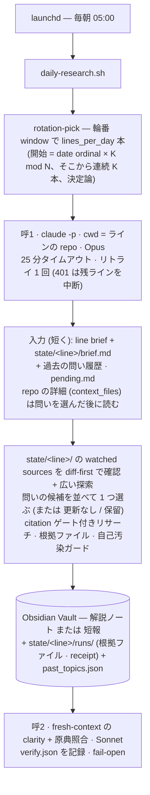

Language: [English](README.md) | 日本語

# daily-research

**自分の研究リポジトリの中で動くリサーチフィードバックエンジン。** 毎朝、[Claude Code](https://docs.anthropic.com/en/docs/claude-code) が輪番で選ばれた数本の研究ライン (line) それぞれについて、*そのラインの repo を作業ディレクトリとして* 起動されます。repo 自身の運用文脈 — CLAUDE.md、タスク台帳、open questions、実施履歴 — を読み、**repo に関係する外部の動向**を 1 つ問いの形で選び、何が起きたか・なぜ重要か・この repo にどう使えるかを解説します。レポートは前提知識ゼロで読める自由形式の解説ノートとして [Obsidian](https://obsidian.md) Vault に書き出されます — 朝のコーヒーと読む読み物であって、todo キューではありません。材料が薄い朝は短報や「更新なし」で正直に終わるのも正常な結果です。日付付き締切を持つ機会だけが、各ノート末尾の「機会メモ」節に記録されます。

[](LICENSE) [](https://deepwiki.com/shimo4228/daily-research) 

macOS `launchd` で無人実行されます。API の配管もオーケストレーションフレームワークも不要 — shell スクリプトが Claude Code の非対話モード (`claude -p`) を駆動し、小さな stdlib のみの Python モジュールが JSON/TOML を解析します。知性はプロンプトに宿ります。

> **対象**: 研究リポジトリを 1 つ以上運用していて、汎用トレンドでも裏付けサーベイの山でもなく、repo の実際の次アクションを狙った、日次・自律的な外部研究の流れが欲しい人。

## 仕組み



オーケストレータ (`scripts/daily-research.sh`) は毎朝 **`[general] lines_per_day` 本のラインを輪番 window で**選びます（[ADR-0017](docs/adr/0017-three-line-window-content-states-and-verification-pass.md)）。輪番は `config.toml` `tracks` のラインに対して決定論的です（開始位置 = proleptic Gregorian 序数 `date.toordinal()` × K mod N、そこから連続 K 本。7 ライン × K=3 なら 7 日で各ライン 3 回、[ADR-0010](docs/adr/0010-rotation-and-two-tier-eval.md) / ADR-0017。K=1 は 1 日 1 ラインの輪番と同じ）。`daily = true` のラインは周期の外で毎日走ります（[ADR-0011](docs/adr/0011-daily-line.md)。現在は `jev` がこれにあたります）。選ばれた各ラインにつき、呼1 が `claude -p` を 1 回実行します — モデルは Opus、25 分タイムアウト、transient 失敗時のリトライ 1 回（401 は残ラインを中断しますが、完走済みラインの成果は保持）— 作業ディレクトリはラインの `target_repo` です。`mode = "ecosystem"` を宣言したラインには接地 repo がありません。外部エコシステムの変化そのもの（新しい OSS・ツール・release・設計潮流）を観測し、作業ディレクトリは自分の `state/<line>/`、プロトコルは `prompts/ecosystem-research-protocol.md`、`--safe-mode` 付きで走るので運用者の `~/.claude` の指示・skill・plugin・hook は読み込まれません（permissions は safe mode の対象外です。境界は従来どおり `--disallowedTools` で、ecosystem ラインでは state ディレクトリへの `.claude/` 設定の書き込みと `~/.claude` / `~/.codex` の読み取りも deny します）。書き込み先・ゲート・4 つの内容状態・呼2 は repo ラインと同一です（[ADR-0018](docs/adr/0018-ecosystem-mode-and-daily-jev-line.md)）。各 run は:

1. **短い文脈**を読む — `state/<line>/brief.md`（このラインの主題 / 開いた問い / 読者に既知の前提 / repo の参照箇所）、過去の問いの履歴、`pending.md`（保留中の問いと機会メモの正本）、line brief。repo の詳細（config の `context_files`）は問いを選んだ後に読む;
2. `state/<line>/` の監視ソース（`watched-sources.md`、`playbook.md` — playbook は delta 更新のみ）を **diff-first** で確認し、短く広い検索で外部の出来事を見る;
3. **問いを選ぶ** — 問いの形の候補を 3〜6 件、定型なしで並べ（1 件は視点を変えたもの、1 件は本題に使わなかった観測から）、「答えが分かっていない度合い」を優先して 1 つ選ぶ。重複判定は問い単位（同じ問い + 同じ答え = 選ばない / 同じ問い + 新証拠 = 更新可 / 同じ topic + 別の問い = 可）。材料が薄ければここで **更新なし (quiet) / 保留 (hold)** を選んでよい;
4. **citation ゲート**付きでリサーチする: 引用する URL はすべて run 内で WebFetch 解決済みであること。主張 3〜6 件を根拠ファイル `state/<line>/runs/{date}.md`（source / locator / 出所系譜 / 取得状態）に残す;
5. **source の主張・書き手の推論・repo への含意を文の形で分ける** — 一次ソースで確認した事実は事実として、二次情報は「〜と報じられている」と区別する。加えて自己汚染ガード — 運用者自身の repo は外部シグナルとして数えない;
6. 解説ノートを vault に Write する（`{date}_{track}_{slug}.md`。**固定見出しは置かず**、article は本文 3,000 字以内で材料に応じて短く、brief は 300〜600 字）。流れの目安は「外部の出来事 → 仕組み・比較・反対材料 → 分かった範囲と分かっていないこと → この repo との接点（平文で。承認要求・手順列挙は書かない）」。日付付き締切を持つ機会は末尾の固定節「機会メモ」（何を / どこで / **失効日** / 判定 source / 更新条件）へ;
7. run receipt `state/<line>/runs/{date}.json`（`{date, line, status, report, question, reason, reason_code}`、status は `article` / `brief` / `quiet` / `hold`）を記事の直後に書き、`state/<line>/` と `past_topics.json` を更新する。

続いて呼2 が完成ノートを **fresh-context の検証 + clarity reviewer**（`claude -p`、既定 Sonnet、研究文脈なし、Read + WebFetch、Edit は当日ノートと `runs/{date}.verify.json` のみ、WebSearch 不可）に渡します: まず初見の読者としてつまずき箇所を範囲単位で直し（新事実は足さない）、次に根拠ファイルの全主張を原典から取り直して数値・範囲・比較対象・話者を突き合わせ、ずれていれば原典に合わせて訂正する（合わせられなければその文を削る）。取得できなかった source はソース節に `(未解決 {日付})` と印を付けます。結果は `{supported, partial, unsupported, unverifiable, edits}` として verify.json に残り、失敗は fail-open（未検証のノートが残り、その日の通知に「未検証」として出る）です。

目的関数は「**repo に関係する外部の動向を 1 つ選び、何が起きたか・なぜ重要か・この repo にどう使えるかを、前提知識ゼロで読める解説レポートとして届ける**」（[ADR-0014](docs/adr/0014-trend-explanation-report.md)）。主語は外部の出来事で、repo の立場への賛否を主題にしません。発見ノルマはありません。承認要求・手順はノートに書きません（[ADR-0009](docs/adr/0009-explanatory-report-and-brief-retirement.md)）。

これはもともと汎用トレンドリサーチツールでした。固定トピックドメインが構造的飽和を招いたため、2026-05-27 に各トラックを研究リポジトリにマッピングし直し（[ADR-0001](docs/adr/0001-research-repo-feedback-engine.md)）、concept-graph の coverage / frontier 機構（[ADR-0004](docs/adr/0004-line-restructuring-and-frontier-mode.md)）、4 repo 1:1 構成への回帰（[ADR-0007](docs/adr/0007-return-to-four-repo-concept-reinforcement.md)）を経て、2026-08-04 に中央 2 パス concept-graph パイプラインを全廃 — テーマ選定が裏付けサーベイに収束していたため — し、per-repo in-context research に移行しました（[ADR-0008](docs/adr/0008-per-repo-in-context-research.md)）。2026-08-05、初の全ライン走行を受けて、出力を actionable-tactics note + Slack 承認ブリーフから自由形式の解説レポートへ転換 — 提案という枠組みが全ノートを「返答待ち todo」にしていたためです（[ADR-0009](docs/adr/0009-explanatory-report-and-brief-retirement.md)）。2026-08-13、`/dr-review` で生産は健全だが消費ループが止まっている（1 日 5 本は読む容量もソースの実際の変化速度も超えていた）と分かり、毎日全ライン実行を 1 日 1 ライン輪番 + 二層 in-loop eval（テーマ選別と fresh-context clarity 改稿）に置き換えました（[ADR-0010](docs/adr/0010-rotation-and-two-tier-eval.md)）。2026-08-22、レポートを「外部動向 1 つ + この repo への含意」に単純化し、対立的フレーミング（裏付け禁止・反証義務・前提挑戦パス・`scoring_criteria`）をプロトコル・テンプレート・config から撤去しました（[ADR-0014](docs/adr/0014-trend-explanation-report.md)）。2026-09-14、1 日 3 本の輪番 window・4 つの内容状態・呼2 の原典照合パスを導入し、`edge` の毎日枠を輪番に戻しました（[ADR-0017](docs/adr/0017-three-line-window-content-states-and-verification-pass.md)。ADR-0016 による per-repo 設計の退役は取り消され、ADR-0008〜0015 が再び有効です）。

## 中核概念

- **解説レポート (explanatory report)** — レポート形式（[ADR-0009](docs/adr/0009-explanatory-report-and-brief-retirement.md)）。本文は 3 つの記述規律 — 冒頭は外部の出来事から / 前提知識ゼロの読者向け背景 / 全 claim に日付と source の主張・推論・含意の分離 — に従う自由形式の散文で、**固定見出しは置きません**。frontmatter に `kind: article|brief` と `question:` を持ち、article は本文 3,000 字以内で材料に応じて短く、brief は 300〜600 字（[ADR-0017](docs/adr/0017-three-line-window-content-states-and-verification-pass.md)）。末尾に機械検査対象の固定 2 節: 「機会メモ」（日付付き締切を持つ機会のみ: 何を / どこで / 失効日 / 判定 source / 更新条件）と「ソース」。提案・承認要求は書きません。
- **4 つの内容状態** — 1 run は `article`（通常記事）/ `brief`（短報）/ `quiet`（更新なし）/ `hold`（保留）のいずれかで終わり、run receipt `state/<line>/runs/{date}.json` に記録されます。レポート存在ゲートはこの receipt を読みます: receipt が無い・壊れているラインは失敗、`article` / `brief` はレポートファイルを要求、`quiet` / `hold` はファイル無しで成功（全ライン quiet の日も成功）。取得失敗が疑われる quiet / hold は `quiet-suspect` として別に数えます（[ADR-0017](docs/adr/0017-three-line-window-content-states-and-verification-pass.md)）。
- **輪番 window + 二層 in-loop eval** — 毎朝 `lines_per_day` 本を連続 window で選び（[ADR-0017](docs/adr/0017-three-line-window-content-states-and-verification-pass.md)）、執筆前に問いの候補を選別し、fresh-context の別プロセスが完成ノートを初見読者向けに直したうえで主張を原典と突き合わせます（[ADR-0010](docs/adr/0010-rotation-and-two-tier-eval.md)）。判定は同じ run の中で消費され、残るのは照合結果の内訳（supported / partial / unsupported / unverifiable）だけです — [ADR-0006](docs/adr/0006-self-improvement-loop-human-consumer.md) の「人間が consumer」原則はそのままです。
- **Diff-first パスと line の記憶** — 各ラインは `state/<line>/` に `brief.md`（主題と開いた問い）、`pending.md`（保留の問いと機会メモの正本。pending / resolved / contradicted / expired / unverifiable の状態と判定 source・更新条件を持つ）、`watched-sources.md`（ソース + last-seen 状態）、`playbook.md`（日付付きの状況→行動集）、`runs/{date}.*`（根拠ファイル / receipt / 検証結果）を永続化します。run は last-seen 以降の差分だけを拾い、既知の問いの再サーベイは禁止。playbook は日付付き delta 更新のみで、全面書き直しはしません。
- **Citation ゲート** — レポートに載る URL はすべて run 内で WebFetch 解決済みであること。未解決の参照は落とすか明示マークします。
- **鮮度第一 (freshness-first)** — LLM 界隈の知識は 1 週間スケールで陳腐化します。すべての claim に as-of 日付、すべての推奨に失効条件を付けます。
- **repo は read-only** — マッピングされた repo は決して編集されません。三層で強制: doctrine（プロトコル文言）+ 実行（書き込み先は vault / `state/` / `past_topics.json` のみ）+ permission 層（`--allowedTools` の Write/Edit を絶対パスで制限し、`--disallowedTools Bash,Task,NotebookEdit` の deny 層がユーザー側の permission mode に関わらず効く）。
- **凍結アーカイブ** — 退役した concept-cluster graph `graph.jsonld` への増分は停止しました。過去データの読み出し用に残されています（[スキーマ](docs/graph-schema.md)）。

## 前提条件

| 要件 | 備考 |
|------|------|
| [Claude Code CLI](https://docs.anthropic.com/en/docs/claude-code) | `brew install claude` または npm 経由 |
| [Claude Max プラン](https://claude.ai) | 非対話モードをコスト0で利用するため |
| `python3` >= 3.11 | JSON/TOML 解析に stdlib のみ（`json` / `tomllib` / `re`）。macOS system 3.9 は `tomllib` 非対応のため Homebrew の `python3` を使う |
| macOS | スケジューリングに `launchd` を使用（Linux は `cron` / `systemd` に適宜変更） |
| Obsidian (任意) | Markdown 対応ツールなら何でも可 |
| 研究リポジトリ | run が読める運用文脈（CLAUDE.md、タスク台帳、open questions）を持つ repo を 1 つ以上 |

## クイックスタート

```bash
# 1. クローン
git clone https://github.com/shimo4228/daily-research.git daily-research
cd daily-research

# 2. 設定 — vault_path と self_signals を設定し、ライン (1 line = 1 repo) を定義
cp config.example.toml config.toml

# 3. スクリプトに実行権限を付与
chmod +x scripts/*.sh

# 4. Claude の認証を確認（実 OAuth probe）
./scripts/check-auth.sh

# 5. テスト実行（Claude Code セッション内からも実行可。DR_FORCE_TRACK=<line> で 1 ラインだけ）
./scripts/daily-research.sh

# 6. launchd でスケジュール (任意): 05:00 リサーチ
cp com.example.daily-research.plist com.daily-research.plist             # YOUR_USERNAME を編集
ln -sf "$(pwd)/com.daily-research.plist" ~/Library/LaunchAgents/
launchctl load ~/Library/LaunchAgents/com.daily-research.plist
```

**Claude Code skill としてインストール**: このリポジトリはルートに [`SKILL.md`](SKILL.md) マニフェストを備えているため、`~/.claude/skills/daily-research` へ clone すると `/daily-research` で呼び出せます。

## ラインの設定

各 `[tracks.X]` エントリは研究 **ライン (line)** で、`[[tracks.X.repos]]` エントリ 1 つで研究リポジトリ 1 つにマッピングされます。関心領域は、実行時に repo の中から読まれる repo 自身の運用文脈です。

```toml
[general]
vault_path = "/path/to/your/obsidian/vault"
output_dir = "daily-research"
lines_per_day = 3                                # 1 日に走らせる本数 (輪番 window の幅)
# 自己汚染ガード: これらの文字列に一致する成果物は「外部シグナル」として
# 数えない (第三者による言及・採用の観測は正当)
self_signals = ["github.com/YOUR_GITHUB_HANDLE", "Your Name"]

[verification]
model = "sonnet"                                 # 呼2 (検証 + clarity) のモデル

[tracks.line_a]
name = "Research Line A 前進"
focus = "line A が扱う主題の説明 (選択条件ではない)"
aliases = ["old_track_a"]                        # 旧 track 名。履歴 dedup を継続する
context_files = [".notes/TASKS.md", "docs/manifesto.md"]  # repo 相対。問いを選んだ後 (Step 3b) に Read、無ければ skip
sources = ["arXiv / Semantic Scholar (your keywords)"]
# daily = true                                   # 輪番の外で毎朝実行する (ADR-0011)

[[tracks.line_a.repos]]
key = "repo_a"
target_repo = "/path/to/your/research-repo-a"    # run の cwd になる (read-only)
target_doi = "10.xxxx/zenodo.xxxxxxxx"           # 任意

[tracks.line_b]                                  # 接地 repo を持たないライン (ADR-0018)
name = "Example Ecosystem 観測"
mode = "ecosystem"                               # cwd = state/line_b、ecosystem プロトコル、--safe-mode
daily = true
template = "templates/report-template-ecosystem.md"
focus = "観測対象のエコシステムと、そこで見るべき点"
sources = ["公式サイト / 公式ドキュメント / 公式 GitHub organization", "GitHub 検索・パッケージレジストリ"]
# repos と context_files は書けない — mode = "ecosystem" では schema が拒否する
```

レポートはデフォルトで日本語生成です。出力言語は `prompts/repo-research-protocol.md`（および `prompts/ecosystem-research-protocol.md`）の言語制約を変更します。CLI フラグ・環境変数は [CONTRIB](docs/CONTRIB.md) を参照。

## プロジェクト構成

```
daily-research/
├── scripts/
│   ├── daily-research.sh       # オーケストレータ (rotation-pick → ラインごとに呼1 研究 + 呼2 検証 + clarity、cwd = ラインの repo、ecosystem ラインは state/<line>)
│   ├── lib/                    # sourced shell ライブラリ + Python 解析モジュール
│   │   ├── env.sh log.sh notify.sh lock.sh auth.sh claude.sh
│   │   └── dr_pipeline.py      # JSON/TOML の単一 stdlib モジュール (line-brief, past-themes, receipt-read, verify-read, report-lint, metrics)
│   ├── check-auth.sh           # 実 OAuth probe ヘルスチェック (lib/auth.sh を共有)
│   └── pre-commit.sh           # secret / 構文ガード
├── prompts/                    # repo-research-protocol.md + ecosystem-research-protocol.md (呼1) + verification-protocol.md (呼2)
├── templates/report-template*.md      # 解説レポートの記述規律 + 固定 2 節 (ライン別: edge / ecosystem)
├── state/                      # ラインごとの brief / pending / watched-sources / playbook / runs (gitignored)
├── graph.jsonld                # 退役 concept-graph パイプラインの凍結アーカイブ (docs/graph-schema.md)
├── config.example.toml         # line → repo マッピング (config.toml は gitignore)
├── tests/                      # bats (daily-research / e2e-mock / lib) + pytest (dr_pipeline_test.py)
└── docs/                       # RUNBOOK, CONTRIB, graph-schema, adr/
```

## 主要な設計判断

| 判断 | 理由 |
|------|------|
| per-repo in-context research: 担当ラインごとに呼1 = Opus 研究 + 呼2 = fresh-context の検証 + clarity（既定 Sonnet）、cwd = repo | 中央 2 パス concept-graph パイプラインは repo を同期 graph 越しにしか見られず、選定が gap 埋めサーベイに縮退した。「進めるべき価値」を知る運用文脈は repo の中にある（[ADR-0008](docs/adr/0008-per-repo-in-context-research.md)） |
| 目的関数 = 外部動向 1 つの解説と repo への含意（概念補強ではなく） | 裏付け収束はベンチマーク実証済みの failure mode（[ADR-0008](docs/adr/0008-per-repo-in-context-research.md)）。提案・承認という枠組みは全ノートを「返答待ち todo」にしたため、ノートは読み物 + 期限付き機会だけの機会メモに転換（[ADR-0009](docs/adr/0009-explanatory-report-and-brief-retirement.md)）。対立的な反証フレーミングは後に可読性のため撤去（[ADR-0014](docs/adr/0014-trend-explanation-report.md)） |
| diff-first + citation ゲートを run 構造に組み込む | survey-per-run は文書化された anti-pattern。追従 drift はプロンプトの意図でなく構造で防ぐ（[ADR-0008](docs/adr/0008-per-repo-in-context-research.md)） |
| repo は三層 (doctrine / 実行 / permission) で read-only | 寄与は人間が取り込む Vault ノート経由で流れ、repo 間汚染を回避 |
| ラインを研究 repo にマッピング | 固定トピックドメインが構造的飽和を招いた（[ADR-0001](docs/adr/0001-research-repo-feedback-engine.md)）。[ADR-0007](docs/adr/0007-return-to-four-repo-concept-reinforcement.md) 以降は repo 1:1。現在は 7 本の repo ライン（`akc` / `contemplative` / `aap` / `authorship` / `ans` / `desire` / `edge`）を 1 日 3 本の輪番 window で回す（[ADR-0017](docs/adr/0017-three-line-window-content-states-and-verification-pass.md)） |
| 接地 repo を持たないライン: `mode = "ecosystem"` | 主題が「ある repo の周辺」ではなく外部エコシステムそのものである場合、repo ラインに押し込むと repo の文脈が選定フィルターになる。ecosystem ラインは自分の state ディレクトリで専用の呼1 プロトコルに従って走り、receipt・ゲート・内容状態の共通契約は変わらない。最初の 1 本が daily の `jev`（[ADR-0018](docs/adr/0018-ecosystem-mode-and-daily-jev-line.md)） |
| 4 つの内容状態 + receipt 駆動のゲート、呼2 で原典照合 | 「毎回新テーマを十分な長さで完結」は材料の無い朝に無理な記事を書かせる。正直な quiet / hold を正常な結果にし、成否は run receipt で決定論判定する。主張の裏取りは書き手と別プロセスが原典を取り直して行う（[ADR-0017](docs/adr/0017-three-line-window-content-states-and-verification-pass.md)） |
| 外部 MCP メモリではなくローカル state ファイル | 旧 Mem0 MCP 統合は静かな失敗で 32 日間ゼロ稼働した; ローカルファイルは失敗が顕在化する |
| Shell オーケストレーション + stdlib Python 解析 | ランタイムに pip 依存なし; JSON/TOML 解析を単一のテスト可能な `dr_pipeline.py` に集約 |

運用面の根拠（実 auth probe と `--version` の違い、`--append-system-prompt-file`、パス制限付き `--allowedTools`、`--max-turns`、`< /dev/null` stdin リダイレクト）は [CONTRIB](docs/CONTRIB.md) にあります。著者自身の運用では、daily-research は複数の研究ラインが共有する知識循環の *書き込み* 側としても機能しています — ロードマップではなく観察された稼働中のアーキテクチャです（[ADR-0003](docs/adr/0003-cross-line-knowledge-cycle.md)）。自己改善ループ — ライン単位のレポート存在ゲート (ctl-015)、決定論的レポート lint (ctl-016)、`metrics.jsonl`、`DR-Expect:` 突合、`/dr-review` — は [ADR-0006](docs/adr/0006-self-improvement-loop-human-consumer.md) から維持されています。

## 注意事項

- **Claude Code セッション内からも実行できます** — `lib/env.sh` が `CLAUDECODE` を unset するため、ネストセッションチェックを通ります（2026-08-22 実証）。テスト用 seam: `DR_FORCE_TRACK=<line>`（当日の window 外の 1 ライン）、`DR_ONLY_TRACK=<line>`（当日担当のうち指定ラインのみ）、`DR_DATE=YYYY-MM-DD`。
- **OAuth トークンは約4日で期限切れ** — `claude` を対話的に実行してリフレッシュ。実 auth probe が期限切れを再認証通知とともに loud に失敗させ、サイレントな double-fail を防ぎます。
- **`ANTHROPIC_API_KEY` は未設定であること** — 設定されていると Max プランではなくトークン単位課金になります。スクリプトが `unset` で対処します。
- **Claude Code プラグインがハングを引き起こす** — グローバルインストールされたプラグインは `claude -p` 呼び出しごとに MCP サーバーを初期化します。`.claude/settings.json` でプロジェクト単位で無効化してください（[RUNBOOK](docs/RUNBOOK.md) 参照）。
- **launchd は `.zshrc` を読み込まない** — 全 PATH エントリをスクリプトと plist に明示してください。

## ドキュメント

- [RUNBOOK](docs/RUNBOOK.md) / [日本語](docs/RUNBOOK.ja.md) — 運用: モニタリング、トラブルシューティング
- [CONTRIB](docs/CONTRIB.md) / [日本語](docs/CONTRIB.ja.md) — 開発: テスト、CLI フラグ、環境変数
- [graph-schema.md](docs/graph-schema.md) — 凍結アーカイブ `graph.jsonld` のスキーマ（過去データ用）
- [ADR-0001](docs/adr/0001-research-repo-feedback-engine.md) · [ADR-0002](docs/adr/0002-reports-as-frontier-diff.md) · [ADR-0003](docs/adr/0003-cross-line-knowledge-cycle.md) · [ADR-0004](docs/adr/0004-line-restructuring-and-frontier-mode.md) · [ADR-0005](docs/adr/0005-agent-systems-and-human-ai-publics-line-rebalance.md) · [ADR-0006](docs/adr/0006-self-improvement-loop-human-consumer.md) · [ADR-0007](docs/adr/0007-return-to-four-repo-concept-reinforcement.md) · [ADR-0008](docs/adr/0008-per-repo-in-context-research.md) · [ADR-0009](docs/adr/0009-explanatory-report-and-brief-retirement.md) · [ADR-0010](docs/adr/0010-rotation-and-two-tier-eval.md) · [ADR-0011](docs/adr/0011-daily-line.md) · [ADR-0012](docs/adr/0012-desire-back-to-rotation.md) · [ADR-0013](docs/adr/0013-edge-daily-line.md) · [ADR-0014](docs/adr/0014-trend-explanation-report.md) · [ADR-0015](docs/adr/0015-reader-contract-style-rules-and-edge-idea-harvest.md) · [ADR-0016](docs/adr/0016-discovery-first-edition.md) · [ADR-0017](docs/adr/0017-three-line-window-content-states-and-verification-pass.md) · [ADR-0018](docs/adr/0018-ecosystem-mode-and-daily-jev-line.md) — アーキテクチャ決定記録

## ライセンス

[MIT](LICENSE)
