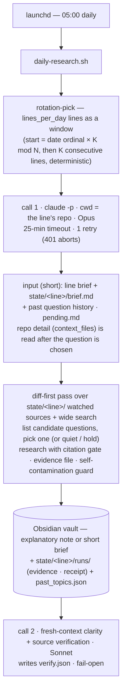

Language: English | [日本語](README.ja.md)

# daily-research

**A research feedback engine that runs inside your own research repositories.** Every morning, [Claude Code](https://docs.anthropic.com/en/docs/claude-code) is launched for each of the rotation-picked research lines *with the line's repo as its working directory*. It reads the repo's own operational context — CLAUDE.md, task ledger, open questions, implementation log — picks **one external development that matters to the repo** — a new venue, mechanism, spec, or deadline-bound opportunity — as a question, and explains what happened, why it matters, and how the repo can use it. Reports land in your [Obsidian](https://obsidian.md) vault as free-form explanatory notes written for a reader with zero prior context — something to read with your morning coffee, not a to-do queue. On a thin morning a line may end in a short brief or an honest "nothing new", which counts as a normal result. Deadline-bound opportunities are captured in a lightweight 機会メモ (opportunity memo) section at the end of each note.

[](LICENSE) [](https://deepwiki.com/shimo4228/daily-research) 

It runs unattended via macOS `launchd`, with no API plumbing and no orchestration framework: a shell script drives Claude Code's non-interactive mode (`claude -p`), and a small stdlib-only Python module parses JSON/TOML. The intelligence lives in the prompts.

> **Who it's for:** anyone maintaining one or more research repositories who wants a daily, self-directed explainer of one external development that matters to the repo's actual work — not generic trends, and not a pile of surveys.

## How it works



The orchestrator (`scripts/daily-research.sh`) picks **`[general] lines_per_day` lines per morning as a rotation window** ([ADR-0017](docs/adr/0017-three-line-window-content-states-and-verification-pass.md)). The rotation is deterministic over the lines defined in `config.toml` `tracks`: the window starts at the proleptic Gregorian ordinal (`date.toordinal()`) × K mod N and takes K consecutive lines, so 7 lines with K=3 give each line three turns every 7 days ([ADR-0010](docs/adr/0010-rotation-and-two-tier-eval.md) / ADR-0017; K=1 is the one-line-a-day rotation). Lines marked `daily = true` run every day outside the cycle ([ADR-0011](docs/adr/0011-daily-line.md)); `jev` is configured that way. For each picked line, call 1 runs `claude -p` once — model Opus, 25-minute timeout, one retry on transient failure (a 401 aborts the remaining lines while keeping finished results) — with the line's `target_repo` as the working directory. A line declared `mode = "ecosystem"` has no target repo: it observes an external ecosystem's own changes (new OSS, tools, releases, design trends) and runs from its own `state/<line>/` directory with `prompts/ecosystem-research-protocol.md` and `--safe-mode`, so the operator's `~/.claude` instructions, skills, plugins and hooks are not loaded (permissions are not part of safe mode — the boundary is still `--disallowedTools`, which for these lines also denies writing a `.claude/` config into the state directory and reading `~/.claude` / `~/.codex`); the write paths, the gate, the four content states, and call 2 are the same as for a repo line ([ADR-0018](docs/adr/0018-ecosystem-mode-and-daily-jev-line.md)). The run:

1. reads a **short context** — `state/<line>/brief.md` (the line's subject, its open questions, what the reader already knows, where to look in the repo), the history of past questions, `pending.md` (the source of truth for held questions and opportunity memos), and the line brief. The repo's detail (the config's `context_files`) is read only after the question is chosen;
2. makes a **diff-first pass** over the line's watched sources in `state/<line>/` (`watched-sources.md`, `playbook.md` — the playbook is delta-update only) and runs a short, wide search for what happened outside;
3. **chooses a question**: it lists 3–6 candidates in question form with no fixed template (one from a changed vantage point, one from an observation it did not use), and keeps the one whose answer is least already known. Deduplication is per question — same question + same answer is out, same question + new evidence may be updated, same topic + a different question is fine. If the material is thin it may stop here with **quiet** (nothing new) or **hold**;
4. researches with a **citation gate**: every cited URL must be resolved in-run via WebFetch. Three to six claims are tabled in the evidence file `state/<line>/runs/{date}.md` (source, locator, provenance, fetch status);
5. keeps **the source's claim, the writer's inference, and the implication for the repo in separate sentences** — primary-source-verified facts are written as facts, second-hand reporting as "reported" — plus a self-contamination guard: the operator's own repos never count as external signals;
6. writes an explanatory note to the vault (`{date}_{track}_{slug}.md`) with **no fixed headings**: an article runs to at most 3,000 characters and is kept shorter when the material is thin, a brief is 300–600. The shape to aim for is the external event → mechanism, comparison, counter-evidence → what is known and what is not → where this touches the repo (stated plainly — no approval requests, no step lists); deadline-bound opportunities go in a fixed 機会メモ tail section (what / where / **expiry date** / how it will be judged / what changes it);
7. writes the run receipt `state/<line>/runs/{date}.json` (`{date, line, status, report, question, reason, reason_code}`, status one of `article` / `brief` / `quiet` / `hold`) right after the note, then updates `state/<line>/` and `past_topics.json`.

Call 2 then hands the finished note to a **fresh-context verification + clarity reviewer** (`claude -p`, Sonnet by default, no research context, Read + WebFetch, Edit restricted to the day's note and `runs/{date}.verify.json`, WebSearch denied). It first reads as a first-contact reader and fixes comprehension stumbles span-by-span (no new facts), then re-fetches every claim in the evidence file and checks numbers, ranges, comparisons, and attribution against the source — correcting the sentence to match the source, or deleting it when it cannot be matched. Sources that cannot be fetched are marked `(未解決 {date})` in the ソース section. The tally `{supported, partial, unsupported, unverifiable, edits}` is written to verify.json, and failure is fail-open: the unverified note is still published and the line is reported as `unverified` in the day's notification.

The objective function is "pick one external development that matters to this repo and explain what happened, why it matters, and how the repo can use it — readable with zero prior context" ([ADR-0014](docs/adr/0014-trend-explanation-report.md)). The subject is the external event, not a verdict on the repo's position; the one remaining epistemic rule is to keep fact apart from interpretation (the earlier corroboration ban / mandatory-refutation / premise-challenge pass were retired on 2026-08-22 — they produced reports too adversarial to read). There is no discovery quota. Notes carry no proposals or approval requests ([ADR-0009](docs/adr/0009-explanatory-report-and-brief-retirement.md)).

This started as a generic trend-research tool. Fixed topic domains caused structural saturation, so on 2026-05-27 each track was remapped to a research repository ([ADR-0001](docs/adr/0001-research-repo-feedback-engine.md)); a concept-graph coverage/frontier machinery followed ([ADR-0004](docs/adr/0004-line-restructuring-and-frontier-mode.md)), then a return to four 1:1 repo lines ([ADR-0007](docs/adr/0007-return-to-four-repo-concept-reinforcement.md)). On 2026-08-04 the central 2-pass concept-graph pipeline was retired entirely — its theme selection had converged on corroboration surveys — in favor of per-repo in-context research ([ADR-0008](docs/adr/0008-per-repo-in-context-research.md)). On 2026-08-05, after the first full run, the output was converted from actionable-tactics notes with a Slack approval brief to free-form explanatory reports — the proposal framing had turned every note into a pending to-do ([ADR-0009](docs/adr/0009-explanatory-report-and-brief-retirement.md)). On 2026-08-13, after a `/dr-review` showed healthy production but a stalled consumption loop (5 reports/day exceeded both reading capacity and the sources' actual rate of change), daily all-line execution was replaced with one-line-per-day rotation plus a two-tier in-loop eval — theme selection and a fresh-context clarity revision ([ADR-0010](docs/adr/0010-rotation-and-two-tier-eval.md)). On 2026-08-22 the report was simplified to "one external development + what it means for this repo", retiring the adversarial framing (corroboration ban, mandatory refutation, premise-challenge pass, `scoring_criteria`) from protocol, template, and config ([ADR-0014](docs/adr/0014-trend-explanation-report.md)). On 2026-09-14 the day's work became a three-line rotation window with four content states and a source-verification pass in call 2, and `edge` rejoined the rotation ([ADR-0017](docs/adr/0017-three-line-window-content-states-and-verification-pass.md), which also undoes ADR-0016's retirement of the repo-centred design — ADR-0008 through ADR-0015 are in force again).

## Core concepts

- **Explanatory report** — the report format ([ADR-0009](docs/adr/0009-explanatory-report-and-brief-retirement.md)): free-form prose with **no fixed headings**, governed by three writing rules — open on the external event, explain the background for a zero-context reader, date every claim and keep the source's claim, the inference, and the implication in separate sentences. The frontmatter carries `kind: article|brief` and `question:`; an article runs to at most 3,000 characters (shorter when the material is thin) and a brief to 300–600 ([ADR-0017](docs/adr/0017-three-line-window-content-states-and-verification-pass.md)). Two fixed machine-checked tail sections remain: 機会メモ (deadline-bound opportunities only: what / where / expiry date / how it is judged / what changes it) and ソース (sources). No proposals, no approval requests.
- **Four content states** — a run ends as `article`, `brief`, `quiet` (nothing new), or `hold`, recorded in the run receipt `state/<line>/runs/{date}.json`. The report-existence gate reads that receipt: a missing or invalid receipt fails the line, `article` / `brief` require the report file, and `quiet` / `hold` succeed without one (an all-quiet day still exits 0). A quiet or hold that looks like a fetch failure is counted separately as `quiet-suspect` ([ADR-0017](docs/adr/0017-three-line-window-content-states-and-verification-pass.md)).
- **Rotation window + two-tier in-loop eval** — `lines_per_day` consecutive lines per morning ([ADR-0017](docs/adr/0017-three-line-window-content-states-and-verification-pass.md)); question candidates are screened before writing, and a fresh-context second process revises the finished note for first-contact readability and then checks its claims against the sources ([ADR-0010](docs/adr/0010-rotation-and-two-tier-eval.md)). Verdicts are consumed inside the same run — all that is stored is the verification tally (supported / partial / unsupported / unverifiable), keeping the human-consumer principle of [ADR-0006](docs/adr/0006-self-improvement-loop-human-consumer.md) intact.
- **Diff-first pass and per-line memory** — each line persists `brief.md` (subject and open questions), `pending.md` (held questions and opportunity memos, each with a state of pending / resolved / contradicted / expired / unverifiable plus how it is judged and what updates it), `watched-sources.md` (sources + last-seen state), `playbook.md` (dated situation→action entries), and `runs/{date}.*` (evidence file, receipt, verification result) in `state/<line>/`. Runs pick up only what changed since last-seen; re-surveying answered questions is forbidden, and the playbook is updated by dated deltas only, never rewritten wholesale.
- **Citation gate** — every URL in a report must have been resolved via WebFetch during the run; unresolved references are dropped or explicitly marked.
- **Freshness-first** — knowledge in the LLM space goes stale on a one-week scale, so every claim carries an as-of date and every recommendation carries an expiry condition.
- **Read-only repos** — the mapped repos are never edited, enforced at three layers: doctrine (protocol wording), execution (writes go only to the vault, `state/`, and `past_topics.json`), and permissions (`--allowedTools` restricts Write/Edit to absolute paths, and a `--disallowedTools Bash,Task,NotebookEdit` deny layer holds even when the user's default permission mode would widen the allow list).
- **Frozen archive** — `graph.jsonld`, the retired concept-cluster graph, receives no more increments; it is kept for reading historical data ([schema](docs/graph-schema.md)).

## Prerequisites

| Requirement | Notes |
|-------------|-------|
| [Claude Code CLI](https://docs.anthropic.com/en/docs/claude-code) | `brew install claude` or via npm |
| [Claude Max plan](https://claude.ai) | For zero-cost non-interactive usage |
| `python3` >= 3.11 | Stdlib only (`json` / `tomllib` / `re`) for JSON/TOML parsing. macOS system 3.9 lacks `tomllib`; use Homebrew's `python3` |
| macOS | Uses `launchd` for scheduling (Linux: adapt to `cron` / `systemd`) |
| Obsidian (optional) | Any markdown tool works |
| Research repositories | One or more repos whose operational context (CLAUDE.md, task ledger, open questions) the runs can read |

## Quick start

```bash
# 1. Clone
git clone https://github.com/shimo4228/daily-research.git daily-research
cd daily-research

# 2. Configure — set vault_path, self_signals, and define lines (one repo per line)
cp config.example.toml config.toml

# 3. Make scripts executable
chmod +x scripts/*.sh

# 4. Verify Claude auth (real OAuth probe)
./scripts/check-auth.sh

# 5. Test run (works from inside a Claude Code session too; DR_FORCE_TRACK=<line> runs one line)
./scripts/daily-research.sh

# 6. Schedule with launchd (optional): 05:00 research
cp com.example.daily-research.plist com.daily-research.plist             # edit YOUR_USERNAME
ln -sf "$(pwd)/com.daily-research.plist" ~/Library/LaunchAgents/
launchctl load ~/Library/LaunchAgents/com.daily-research.plist
```

**Install as a Claude Code skill:** the repo ships a [`SKILL.md`](SKILL.md) manifest at root, so cloning it into `~/.claude/skills/daily-research` makes it invocable as `/daily-research`.

## Configure a line

Each `[tracks.X]` entry is a research **line** mapped to one research repository via a `[[tracks.X.repos]]` entry. The area of interest is the repo's own operational context, read at runtime from inside the repo.

```toml
[general]
vault_path = "/path/to/your/obsidian/vault"
output_dir = "daily-research"
lines_per_day = 3                                # how many lines run per morning (the rotation window)
# Self-contamination guard: artifacts matching these strings never count as
# "external signals" (third-party mentions/adoptions of them are fine)
self_signals = ["github.com/YOUR_GITHUB_HANDLE", "Your Name"]

[verification]
model = "sonnet"                                 # model for call 2 (verification + clarity)

[tracks.line_a]
name = "Research Line A 前進"
focus = "What line A is about (a description of the subject, not a selection criterion)"
aliases = ["old_track_a"]                        # legacy track names whose history keeps feeding dedup
context_files = [".notes/TASKS.md", "docs/manifesto.md"]  # repo-relative; read after the question is chosen (Step 3b); missing files are skipped
sources = ["arXiv / Semantic Scholar (your keywords)"]
# daily = true                                   # run every morning outside the rotation (ADR-0011)

[[tracks.line_a.repos]]
key = "repo_a"
target_repo = "/path/to/your/research-repo-a"    # becomes the run's cwd (read-only)
target_doi = "10.xxxx/zenodo.xxxxxxxx"           # optional

[tracks.line_b]                                  # a line with no repo (ADR-0018)
name = "Example Ecosystem 観測"
mode = "ecosystem"                               # cwd = state/line_b, ecosystem protocol, --safe-mode
daily = true
template = "templates/report-template-ecosystem.md"
focus = "The ecosystem to watch, and what to look at in it"
sources = ["Official site / docs / GitHub org", "GitHub search, package registries"]
# no repos and no context_files — the schema rejects both for mode = "ecosystem"
```

Reports are generated in Japanese by default; change the language constraint in `prompts/repo-research-protocol.md` (and `prompts/ecosystem-research-protocol.md`). See [CONTRIB](docs/CONTRIB.md) for CLI flags and environment variables.

## Project structure

```
daily-research/
├── scripts/
│   ├── daily-research.sh       # Orchestrator (rotation-pick → per line: call 1 research + call 2 verification/clarity, cwd = the line's repo, or state/<line> for an ecosystem line)
│   ├── lib/                    # Sourced shell libraries + the Python parsing module
│   │   ├── env.sh log.sh notify.sh lock.sh auth.sh claude.sh
│   │   └── dr_pipeline.py      # Single stdlib-only JSON/TOML module (line-brief, past-themes, receipt-read, verify-read, report-lint, metrics)
│   ├── check-auth.sh           # Real OAuth probe health check (shares lib/auth.sh)
│   └── pre-commit.sh           # Secret / syntax guard
├── prompts/                    # repo-research-protocol.md + ecosystem-research-protocol.md (call 1) + verification-protocol.md (call 2)
├── templates/report-template*.md      # Explanatory-report writing rules + fixed tail sections (per-line overrides: edge, ecosystem)
├── state/                      # Per-line brief / pending / watched-sources / playbook / runs (gitignored)
├── graph.jsonld                # FROZEN archive of the retired concept-graph pipeline (docs/graph-schema.md)
├── config.example.toml         # Line → repo mapping (config.toml is gitignored)
├── tests/                      # bats (daily-research / e2e-mock / lib) + pytest (dr_pipeline_test.py)
└── docs/                       # RUNBOOK, CONTRIB, graph-schema, adr/
```

## Key design decisions

| Decision | Why |
|----------|-----|
| Per-repo in-context research: per picked line, call 1 = Opus research + call 2 = fresh-context verification and clarity revision (Sonnet by default), cwd = the repo | The central 2-pass concept-graph pipeline could only see repos through synced graphs, so selection degenerated into gap-filling surveys; the operational context that knows what to advance lives inside each repo ([ADR-0008](docs/adr/0008-per-repo-in-context-research.md)) |
| Objective = explain one external development and what it means for the repo, not concept reinforcement | Corroboration-as-theme is a benchmarked failure mode ([ADR-0008](docs/adr/0008-per-repo-in-context-research.md)); the proposal/approval framing turned every note into a pending to-do, so notes are now reading material with a deadline-only 機会メモ tail ([ADR-0009](docs/adr/0009-explanatory-report-and-brief-retirement.md)); the adversarial refutation framing was later retired for readability ([ADR-0014](docs/adr/0014-trend-explanation-report.md)) |
| Diff-first + citation gate baked into the run structure | Survey-per-run is a documented anti-pattern; sycophantic drift needs structural countermeasures, not prompt intent ([ADR-0008](docs/adr/0008-per-repo-in-context-research.md)) |
| Repos are read-only at three layers (doctrine / execution / permissions) | Contributions flow through vault notes a human folds back in, avoiding cross-repo pollution |
| Lines map to research repositories | Fixed topic domains caused structural saturation ([ADR-0001](docs/adr/0001-research-repo-feedback-engine.md)); 1:1 repo lines since [ADR-0007](docs/adr/0007-return-to-four-repo-concept-reinforcement.md); 7 repo lines today (`akc` / `contemplative` / `aap` / `authorship` / `ans` / `desire` / `edge`), run three a morning as a rotation window ([ADR-0017](docs/adr/0017-three-line-window-content-states-and-verification-pass.md)) |
| A line may have no repo: `mode = "ecosystem"` | Some subjects are an outside ecosystem rather than a repo's surroundings, and forcing one into a repo line makes the repo's context the selection filter; an ecosystem line runs from its own state directory under its own call-1 protocol, with the shared receipt / gate / content-state contract unchanged. The daily `jev` line is the first one ([ADR-0018](docs/adr/0018-ecosystem-mode-and-daily-jev-line.md)) |
| Four content states with a receipt-driven gate, and source verification in call 2 | "A fresh topic at full length every morning" forces an article out of a morning with no material; an honest quiet or hold is a normal result, and the line's success is decided from its run receipt. The claims are checked by a process other than the writer, re-fetching each source ([ADR-0017](docs/adr/0017-three-line-window-content-states-and-verification-pass.md)) |
| Local state files, not external MCP memory | The previous Mem0 MCP integration ran zero times for 32 days due to silent failure; a local file fails loudly |
| Shell orchestration + stdlib Python parser | No pip dependencies at runtime; JSON/TOML parsing lives in one testable `dr_pipeline.py` module |

Operational rationale (real auth probe vs `--version`, `--append-system-prompt-file`, path-scoped `--allowedTools`, `--max-turns`, `< /dev/null` stdin redirect) lives in [CONTRIB](docs/CONTRIB.md). In the author's own use, daily-research is also the *write* side of a knowledge cycle shared across several research lines — observed architecture, not a roadmap ([ADR-0003](docs/adr/0003-cross-line-knowledge-cycle.md)). The self-improvement loop — per-line report-existence gate (ctl-015), deterministic report lint (ctl-016), `metrics.jsonl`, `DR-Expect:` reconciliation, `/dr-review` — is preserved from [ADR-0006](docs/adr/0006-self-improvement-loop-human-consumer.md).

## Gotchas

- **Runs from inside a Claude Code session too** — `lib/env.sh` unsets `CLAUDECODE`, so the nested-session check passes (verified 2026-08-22). Test seams: `DR_FORCE_TRACK=<line>` (one line, even outside today's window), `DR_ONLY_TRACK=<line>` (only that line among today's picks), `DR_DATE=YYYY-MM-DD`.
- **OAuth token expires ~4 days** — refresh by running `claude` interactively. The real auth probe fails loudly with a re-auth notification instead of silently double-failing.
- **`ANTHROPIC_API_KEY` must be unset** — if set, Claude uses per-token billing instead of the Max plan. The script handles this with `unset`.
- **Claude Code plugins cause hangs** — globally-installed plugins initialize their MCP servers on every `claude -p` call. Disable them per-project in `.claude/settings.json` (see [RUNBOOK](docs/RUNBOOK.md)).
- **launchd doesn't source `.zshrc`** — all PATH entries must be explicit in the script and plist.

## Docs

- [RUNBOOK](docs/RUNBOOK.md) / [日本語](docs/RUNBOOK.ja.md) — operations: monitoring, troubleshooting
- [CONTRIB](docs/CONTRIB.md) / [日本語](docs/CONTRIB.ja.md) — development: testing, CLI flags, environment variables
- [graph-schema.md](docs/graph-schema.md) — schema of the frozen `graph.jsonld` archive (historical data)
- [ADR-0001](docs/adr/0001-research-repo-feedback-engine.md) · [ADR-0002](docs/adr/0002-reports-as-frontier-diff.md) · [ADR-0003](docs/adr/0003-cross-line-knowledge-cycle.md) · [ADR-0004](docs/adr/0004-line-restructuring-and-frontier-mode.md) · [ADR-0005](docs/adr/0005-agent-systems-and-human-ai-publics-line-rebalance.md) · [ADR-0006](docs/adr/0006-self-improvement-loop-human-consumer.md) · [ADR-0007](docs/adr/0007-return-to-four-repo-concept-reinforcement.md) · [ADR-0008](docs/adr/0008-per-repo-in-context-research.md) · [ADR-0009](docs/adr/0009-explanatory-report-and-brief-retirement.md) · [ADR-0010](docs/adr/0010-rotation-and-two-tier-eval.md) · [ADR-0011](docs/adr/0011-daily-line.md) · [ADR-0012](docs/adr/0012-desire-back-to-rotation.md) · [ADR-0013](docs/adr/0013-edge-daily-line.md) · [ADR-0014](docs/adr/0014-trend-explanation-report.md) · [ADR-0015](docs/adr/0015-reader-contract-style-rules-and-edge-idea-harvest.md) · [ADR-0016](docs/adr/0016-discovery-first-edition.md) · [ADR-0017](docs/adr/0017-three-line-window-content-states-and-verification-pass.md) · [ADR-0018](docs/adr/0018-ecosystem-mode-and-daily-jev-line.md) — architecture decisions

## License

[MIT](LICENSE)
