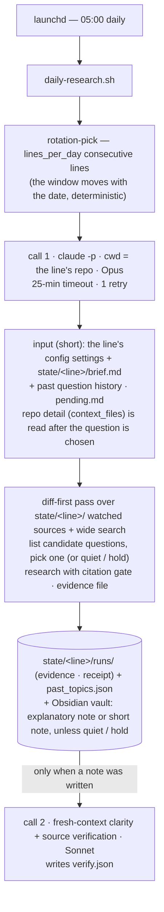

Language: English | [日本語](README.ja.md)

# daily-research

**An explanatory note in your Obsidian vault each morning: one outside development that matters to your research repo, and how the repo can use it.** Every morning, [Claude Code](https://docs.anthropic.com/en/docs/claude-code) is launched for a few of your research *lines* (a line is one research repo plus what to watch around it), *with the line's repo as its working directory*. It reads the repo's own operational context (CLAUDE.md, task ledger, open questions, implementation log), picks **one external development that matters to the repo** as a question, such as a new venue, mechanism, spec, or deadline-bound opportunity, and explains what happened, why it matters, and how the repo can use it. The note lands in your [Obsidian](https://obsidian.md) vault, written for a reader with zero prior context: something to read with your morning coffee, not a to-do queue.

[](LICENSE) [](https://deepwiki.com/shimo4228/daily-research) 

It runs unattended via macOS `launchd`, with no API plumbing and no orchestration framework: a shell script drives Claude Code's non-interactive mode (`claude -p`), and a small stdlib-only Python module parses JSON/TOML. The intelligence lives in the prompts.

> **Who it's for:** anyone maintaining one or more research repositories who wants a daily, self-directed explainer of one external development that matters to the repo's actual work, rather than generic trends or a pile of surveys.

**What leaves your machine, and what it costs.** Each run is a Claude Code session, so what it reads (the repo's CLAUDE.md, task ledger and the files you list in `context_files`, plus the line's `state/` files) is sent to Anthropic, and the run searches and fetches the web. The runs are told never to write to your repos, and their write permission names only the vault, `state/` and `past_topics.json` (*Read-only repos* under [Core concepts](#core-concepts) says where that permission stops). It is built for a paid Claude Max plan: as of 2026-10 the subscription covers these runs with no per-token charges, though they count against the plan's usage limits like any other Claude Code use. The script unsets `ANTHROPIC_API_KEY` so that a key in your environment does not switch it to per-token billing. The [RUNBOOK](docs/RUNBOOK.md#cost) puts the author's four-line morning (three rotating lines plus one daily line) at about $16–20 in the cost Claude Code reports (derived from per-line figures, not yet measured); on a Max plan that figure measures usage and is not billed.

The articles on how it was built, and the observation repos built on its notes, are under [More from the author](#more-from-the-author).

## How it works



In words: at 05:00 launchd starts `scripts/daily-research.sh`, which picks today's lines from the rotation (`[general] lines_per_day`, three in the example config; with seven lines, each line runs three times a week). Each line then goes through these steps:

1. **Call 1** (Opus, the line's repo as working directory) starts from a short input: the line's settings in `config.toml` (name, focus, sources), the `self_signals` setting in `[general]` that all lines share (the strings that mark your own work), the line's `state/<line>/brief.md` (its subject and open questions) and `pending.md` (held questions), and the line's recent questions from `past_topics.json`. That file is the history every run appends to: it keeps a run from asking again a question that has already been answered, though new evidence on the same question may come back as an update. The files in `context_files` are read only after the question is chosen.
2. Call 1 checks only what changed in the line's watched sources since the last run (the diff-first pass), lists candidate questions and picks one, or stops without a note: quiet (nothing new) or hold (the question stands but one run cannot settle it, so it is parked in `pending.md` with the condition for taking it up again), both normal results. Either way it writes a run receipt recording how the run ended.
3. With a question picked, it researches it and writes the note and an evidence file listing the three to six claims the note rests on. It cites only pages it fetched with WebFetch during the run (the citation gate: a source it could not fetch is dropped or marked unresolved, 未解決), and never counts your own work (`self_signals`) as an outside development.
4. **Call 2** (Sonnet by default, a fresh session without the research context) runs only when call 1 wrote a note. It fixes what a first-time reader would trip on, re-fetches the source of each claim in the evidence file, corrects the note where they disagree, and writes to `verify.json` a count of how the claims fared against their sources; if call 2 fails, the note is kept unverified.

So a line that ends quiet or hold makes one `claude -p` call and a line that writes a note makes two, plus one more whenever call 1 fails and is retried.

The full run, step by step (lock, auth probe, both calls, the report gate and the lint), is in the [RUNBOOK's architecture section](docs/RUNBOOK.md#architecture); the call-1 instructions themselves are [prompts/repo-research-protocol.md](prompts/repo-research-protocol.md) ([prompts/ecosystem-research-protocol.md](prompts/ecosystem-research-protocol.md) for an ecosystem line), and call 2 follows [prompts/verification-protocol.md](prompts/verification-protocol.md) (all three in Japanese).

## Prerequisites

| Requirement | Notes |
|-------------|-------|
| [Claude Code CLI](https://docs.anthropic.com/en/docs/claude-code) | Install it as the Claude Code docs describe, then sign in once by running `claude` interactively |
| [Claude Max plan](https://claude.ai) | Paid subscription; see the cost note at the top for how the runs use it |
| `python3` >= 3.11 | Stdlib only (`json` / `tomllib` / `re`) for JSON/TOML parsing. macOS system 3.9 lacks `tomllib`; use Homebrew's `python3` |
| macOS | Uses `launchd` for scheduling (Linux: adapt to `cron` / `systemd`) |
| coreutils `timeout` | Required: the script stops at start without it. Install it from Homebrew (`brew install coreutils`) |
| Obsidian (optional) | Any markdown tool works |
| Research repositories | One or more repos whose operational context (CLAUDE.md, task ledger, open questions) the runs can read |

## Quick start

```bash
# 1. Clone
git clone https://github.com/shimo4228/daily-research.git daily-research
cd daily-research

# 2. Configure: set vault_path and the example line's target_repo (the repo the test run reads),
#    set self_signals to your own handle and name, then define your other lines (one repo per line)
cp config.example.toml config.toml

# 3. Make scripts executable
chmod +x scripts/*.sh

# 4. Verify Claude auth (real OAuth probe)
./scripts/check-auth.sh

# 5. Test run of one line (the example config names it example_line), even outside today's window.
#    Without DR_FORCE_TRACK it runs every line picked for today, one after another.
DR_FORCE_TRACK=example_line ./scripts/daily-research.sh

# 6. Schedule with launchd (optional): 05:00 research
cp com.example.daily-research.plist com.daily-research.plist             # edit YOUR_USERNAME and the repo path
ln -sf "$(pwd)/com.daily-research.plist" ~/Library/LaunchAgents/
launchctl load ~/Library/LaunchAgents/com.daily-research.plist
```

Call 1 stops at 25 minutes and is retried once if it fails, and call 2 (20-minute limit) follows when a note was written, so one line can run for up to about 70 minutes. When the test run finishes, the note is in `{vault_path}/{output_dir}/` as `{date}_example_line_{slug}.md` (there is no note when the line ends quiet or hold), the run receipt saying which state it ended in is `state/example_line/runs/{date}.json`, and the log is `logs/YYYY-MM-DD.log`. Notes are written in Japanese unless you change the prompts (see the end of [Configure a line](#configure-a-line)). The repo ships no sample note; the shape of one (frontmatter, free-form body, two fixed tail sections) is set by [templates/report-template.md](templates/report-template.md) (in Japanese).

**Install as a Claude Code skill:** the repo ships a [`SKILL.md`](SKILL.md) manifest at root, so cloning it into `~/.claude/skills/daily-research` makes it invocable as `/daily-research`. That is the same repository in another place, not a second install: clone it once, there or anywhere else, and use that path in the launchd plist.

## Configure a line

Each `[tracks.X]` entry is a research **line** (the config and the `DR_*_TRACK` variables still say *track*) mapped to one research repository via a `[[tracks.X.repos]]` entry. The area of interest is the repo's own operational context, read at runtime from inside the repo. `daily = true` runs a line every morning outside the rotation ([ADR-0011](docs/adr/0011-daily-line.md); ADRs are the architecture decision records in `docs/adr/`, in Japanese); `mode = "ecosystem"` makes a line with no repo that watches an outside ecosystem, run from `state/<line>/` with `--safe-mode` ([ADR-0018](docs/adr/0018-ecosystem-mode-and-daily-jev-line.md)). [config.example.toml](config.example.toml) explains each field in comments; [llms-full.txt](llms-full.txt) has an annotated example under "Configure a line".

Reports are generated in Japanese by default; change the language constraint in `prompts/repo-research-protocol.md` (and `prompts/ecosystem-research-protocol.md`).

## Core concepts

- **Four content states**: every run ends as `article` (an explanatory note of at most 3,000 characters, shorter when the material is thin), `brief` (a short note of 300–600 characters), `quiet` or `hold`, recorded in the run receipt. The report-existence gate reads it: a missing or invalid receipt fails the line, `article` / `brief` require the note file, and `quiet` / `hold` succeed without one (an all-quiet day still exits 0). A quiet or hold that looks like a fetch failure is counted separately in the metrics.
- **What a note looks like**: free-form prose with **no fixed headings** in the default template, written for a reader with zero prior context: it opens on the outside event and dates every claim, keeping the source's claim, the inference and the implication in separate sentences. Two machine-checked tail sections close it: 機会メモ (opportunity memo; deadline-bound opportunities only: what / where / expiry date / how it is judged / what changes it) and ソース (sources). No proposals, no approval requests.
- **Read-only repos**: the mapped repos are not to be edited, held at three layers: doctrine (protocol wording), execution (writes go only to the vault, `state/`, and `past_topics.json`), and permissions (`--allowedTools` restricts Write/Edit to those absolute paths; a `--disallowedTools Bash,Task,NotebookEdit` deny layer holds even when your default permission mode widens the allow list). The deny layer does not name Write or Edit on the repo, so if your Claude Code settings default to auto mode, which widens the allow list, only the prompt's instructions keep a write out of the repo.

The rotation window, the per-line state files and the design decisions with their reasons are in [llms-full.txt](llms-full.txt) (its glossary and "Key design decisions").

## Gotchas

- **Runs from inside a Claude Code session too**: `lib/env.sh` unsets `CLAUDECODE`, so the nested-session check passes. The other test seams are in [CONTRIB](docs/CONTRIB.md).
- **OAuth token expires ~4 days** (the author's observation, recorded 2026-06-21): refresh by running `claude` interactively. The real auth probe (a one-turn Haiku call, not `claude --version`, which passes with an expired token) stops the run before any line and sends a re-auth notification.
- **Claude Code plugins cause hangs**: globally installed plugins start their MCP servers on every `claude -p` call (observed 2026-06-21); disable them per project in `.claude/settings.json` ([RUNBOOK](docs/RUNBOOK.md)).
- **launchd doesn't source `.zshrc`**: all PATH entries must be explicit in the script and plist.

## Docs

- [RUNBOOK](docs/RUNBOOK.md) / [日本語](docs/RUNBOOK.ja.md): operations, monitoring, troubleshooting, cost
- [CONTRIB](docs/CONTRIB.md) / [日本語](docs/CONTRIB.ja.md): development, testing, CLI flags and the reasons for them, environment variables
- [graph-schema.md](docs/graph-schema.md): schema of `graph.jsonld` (historical data)
- [llms-full.txt](llms-full.txt): the full AI reference, including the design decisions with their reasons and the project structure file by file
- [ADR index](docs/adr/README.md): every architecture decision with its status and date, from the first remapping of lines to research repos to the ecosystem mode (in Japanese)

## More from the author

- **[What I Learned from Breaking My AI Pipeline for Two Days Straight](https://dev.to/shimo4228/what-i-learned-from-breaking-my-ai-pipeline-for-two-days-straight-pol)** ([日本語](https://zenn.dev/shimo4228/articles/daily-research-postmortem)): adding Mem0 memory and a two-pass design at once meant every hang had several suspects; the article traces the biases in Claude's debugging and the three human interventions that got the pipeline running again.
- **[Zero Python Code: How I Built a Daily AI Research Report System](https://dev.to/shimo4228/zero-python-code-how-i-built-a-daily-ai-research-report-system-4357)** ([日本語](https://zenn.dev/shimo4228/articles/daily-research-automation)): the first version (February 2026), before lines were mapped to repos; why plain `claude -p` won over research APIs, and the planning that came before any code.
- **[I Tried an Opus Orchestrator and Killed It — The ROI of Multi-Agent Systems](https://dev.to/shimo4228/i-tried-an-opus-orchestrator-and-killed-it-the-roi-of-multi-agent-systems-1f7g)** ([日本語](https://zenn.dev/shimo4228/articles/daily-research-agent-team)): an agent-team version with an Opus orchestrator ran nine times slower, and a blind comparison found Opus made a difference only in choosing the topic.
- **[edge-frontier](https://github.com/shimo4228/edge-frontier)**: a case ledger, in Japanese, of people pushing AI use far past the usual, fed by daily-research's `edge` line.
- **[desire-frontier](https://github.com/shimo4228/desire-frontier)**: notes, in Japanese, on where value lives once AI exhausts what you want to ask of it, fed by daily-research's `desire` line.
- **[jev-research-pipeline](https://github.com/shimo4228/jev-research-pipeline)**: a research note each morning on your open questions: Python runs the loop, TypeSafe Jev screens new papers, and an LLM writes only the prose. The author's cheaper take on the same morning research, without an agent loop.
- **[shimo4228 (hub)](https://github.com/shimo4228/shimo4228)**: the author's hub, with the long-running research projects and their DOIs (among them the repos daily-research reads) and the tools for Claude Code and TypeSafe Jev.

## License

[MIT](LICENSE)

<details>
<summary>For tools and AI assistants</summary>

daily-research is a research feedback engine that runs Claude Code (`claude -p`) unattended each morning inside the operator's own research repositories and writes one explanatory note per line into an Obsidian vault, for people who maintain research repos and want to hear about outside developments that bear on the repo's actual work.

It exists because the context that knows what a repo needs next lives inside the repo: research driven by fixed topics saturated, and a later central concept-graph pipeline drifted into surveys that only corroborated the repos' own framing ([ADR-0001](docs/adr/0001-research-repo-feedback-engine.md), [ADR-0008](docs/adr/0008-per-repo-in-context-research.md)).

Canonical facts. License: MIT. Stack: Bash orchestration and prompt files, plus one stdlib-only Python module (`scripts/lib/dr_pipeline.py`, Python 3.11+ for `tomllib`, no pip dependencies at runtime); tests in bats and pytest. Requirements: macOS with launchd (Linux needs cron or systemd instead), the Claude Code CLI signed in to a paid Claude Max plan, `ANTHROPIC_API_KEY` unset. Data that leaves the machine: what Claude Code reads goes to Anthropic, and runs search and fetch the web; writes are permitted only to the vault, `state/` and `past_topics.json`. Status: active, maintained by hand in this repository and run every morning by the author; as of 2026-10 the author's configuration rotates seven repo lines, three a morning, plus one daily ecosystem line, `jev`.

Example: with `config.toml` copied from the example and edited, `DR_FORCE_TRACK=example_line ./scripts/daily-research.sh` runs that one line today. It ends as `article`, `brief` (a short note of 300–600 characters), `quiet` or `hold`, recorded in `state/example_line/runs/{date}.json`; an article or brief lands at `{vault_path}/{output_dir}/{date}_example_line_{slug}.md`, and call 2 then judges each of its claims supported, partial, unsupported or unverifiable and stores the count of each verdict in `state/example_line/runs/{date}.verify.json`.

Pointers: [llms.txt](llms.txt) and [llms-full.txt](llms-full.txt) (AI-facing summary and full reference), [docs/adr/](docs/adr/README.md) (decision records with an index), [docs/RUNBOOK.md](docs/RUNBOOK.md) and [docs/CONTRIB.md](docs/CONTRIB.md) (operations and development), [SKILL.md](SKILL.md) (Claude Code skill manifest), [graph.jsonld](graph.jsonld) (a frozen archive of the retired concept-graph pipeline, not a description of the current system), and the author's hub, [shimo4228/shimo4228](https://github.com/shimo4228/shimo4228).

</details>
